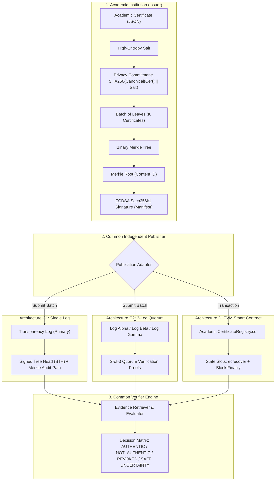

# uniVeri: Academic Certificate Verification & Comparative Publication Architecture

[](https://opensource.org/licenses/MIT)
[](https://www.typescriptlang.org/)
[](https://soliditylang.org/)
[](https://hardhat.org/)
[](https://vitejs.dev/)

**uniVeri** is a high-integrity academic certificate verification and publication benchmarking prototype. It provides a standardized cryptographic pipeline and directly benchmarks three distinct publication architectures:

1. **C1 (Single Transparency Log):** Append-only transparency log with Signed Tree Heads (STH) and cryptographic Merkle audit inclusion proofs.
2. **C2 (3-Log Multi-Quorum):** Distributed log cluster requiring at least a 2-of-3 independent quorum of valid inclusion proofs.
3. **D (EVM Blockchain Registry):** Permissionless, on-chain smart contract registry on Ethereum/EVM with on-chain ECDSA signature verification (`ecrecover`), storage-slot mapping, and event-based auditability.

---

## Architecture Overview



---

## Key Features

### 1. Common Cryptographic Core & Privacy Protection
- **RFC 8785 Canonical JSON Serialization:** Deterministic byte-exact hashing regardless of JSON key order.
- **Privacy-Preserving Commitments:** Raw student personal identifiable information (PII) never leaves the institution. Only `SHA256(Canonical(Cert) || Salt)` leaves enter the public Merkle tree.
- **Binary Merkle Tree:** Deterministic sorted leaf pairing, leaf hashing (`0x00` prefix), and node hashing (`0x01` prefix) with verifiable inclusion proofs.
- **Institutional ECDSA Signatures:** secp256k1 institutional signatures compatible with EVM ABI encoding and standard X.509 / Web3 keypairs.

### 2. Evaluated Publication Architectures
| Property | C1: Single Transparency Log | C2: 3-Log 2-of-3 Quorum | D: On-Chain EVM Registry |
|---|---|---|---|
| **Publication Method** | HTTP REST / In-Memory Log Engine | Multi-Log Cluster Orchestration | Live EVM Transaction (`registerBatch`) |
| **Trust Model** | Single Log Operator | Decentralized Quorum (2-of-3) | Trustless EVM Consensus |
| **Evidence Artifact** | Signed Tree Head (STH) + Audit Path | Distinct Multi-Log Inclusions | Block Finality + Transaction Receipt |
| **Fault Tolerance** | Zero tolerance to log downtime | Resilient to single log outage/omission | Resilient to node failure; subject to RPC/gas |
| **Cost Profile** | Zero on-chain fees | Zero on-chain fees | ~183,624 to 217,910 Gas per batch |
| **Verification Speed** | Fast (~55 ms median) | Fast (~70 ms median) | Ultra-fast local/RPC query (~21 ms) |

### 3. Formal Verification Vocabulary & Safe Uncertainty Semantics
The verification engine strictly adheres to standardized security semantics:
- **`AUTHENTIC`**: Cryptographic integrity valid, issuer signature verified, evidence proven in target publication architecture, and active status confirmed.
- **`NOT_AUTHENTIC`**: Signature invalid, Merkle proof mismatch, or corrupted commitment.
- **`REVOKED_AS_OF_EVIDENCE`**: Explicit on-chain revocation or revocation log entry verified.
- **`SAFE UNCERTAINTY` (`NO_REVOCATION_OBSERVED` / `STATUS_UNKNOWN`)**: Correctly distinquishes between complete proof of validity vs. degraded network states (e.g., when a log is offline in C2, producing safe partial evidence rather than false assertions).

### 4. Live EVM Smart Contract (`AcademicCertificateRegistry.sol`)
- **Gas Optimization:** Uses packed storage slots, efficient mapping structures, and custom error types.
- **Permissionless Registration:** Anyone can relay a batch publication transaction; authorization is validated directly on-chain via `ecrecover` against the registered issuer address.
- **Replay & Collision Protection:** Enforces strict uniqueness between `contentId` (Merkle root) and `logicalBatchId`.

---

## Experimental Benchmark Engine & Results

The repository includes a comprehensive benchmark suite evaluated across a 240-run matrix:
- **Workload Sizes:** Workloads W1–W6 scaling $N \in \{1,000, 10,000, 50,000\}$ certificates and $K \in \{100, 1,000, 10,000\}$ batch sizes.
- **Failure Interventions:** 6 fault injection scenarios (C1 Log Outage, C1 Omission, C2 Single Log Outage, C2 Single Log Omission, D RPC Outage, D Delayed Processing).
- **Total Executions:** **20,850 publication trials** executed on real Hardhat EVM and log clusters, with **420 verification queries**.

### Benchmark Summary

```
================================================================================
ARCHITECTURE PERFORMANCE & RESILIENCE SUMMARY
================================================================================
Architecture       Total Trials   Success Rate   Median Latency   p95 Latency   Gas / Batch
--------------------------------------------------------------------------------
C1 (Single Log)    6,950          97.12%         55.10 ms         71.43 ms      N/A
C2 (3-Log Quorum)  6,950          100.00%        70.08 ms         104.18 ms     N/A
D (EVM Registry)   6,950          97.12%         21.52 ms         26.22 ms      183k-217k gas
================================================================================
```

---

## Interactive UI Studio

The built-in React & Vite web interface provides full visual interactivity:
- **Architecture Diagram:** Interactive visualization of data flows across C1, C2, and D.
- **Batching Studio:** Live certificate generation, canonicalization, privacy salting, and Merkle tree generation.
- **Publication Inspector:** Inspect real-time batch submissions, transaction receipts, STHs, and quorum responses.
- **Verification Portal:** Interactive verification with built-in tampering simulators (tamper certificate data, alter signatures, invalidate Merkle paths).
- **Experiment Dashboard:** Live benchmark runner and real-time visualization of latency distributions and gas consumption.

To start the UI:
```bash
npm run dev:ui
```
Open [http://localhost:3000](http://localhost:3000) in your browser.

---

## Project Structure

```
uniVeri/
├── contracts/                              # Smart Contracts
│   └── AcademicCertificateRegistry.sol     # Core EVM registry with ecrecover & revocation
├── src/
│   ├── benchmark/                          # Experiment & Benchmarking Suite
│   │   ├── experiment-runner.ts            # W1-W6 workload runner & fault injection
│   │   ├── metrics.ts                      # Latency, throughput, and gas collectors
│   │   ├── runner.ts                       # CLI benchmark entrypoint
│   │   └── validate-artifacts.ts           # Artifact completeness & validation validator
│   ├── core/                               # Cryptographic Foundations
│   │   ├── canonical.ts                    # RFC 8785 Canonical JSON
│   │   ├── certificate.ts                  # Certificate models & commitment generation
│   │   ├── manifest.ts                     # Signed Batch Manifests
│   │   ├── merkle.ts                       # Binary Merkle Tree implementation
│   │   └── types.ts                        # Shared TypeScript interfaces
│   ├── publisher/                          # Publication Layer
│   │   └── independent-publisher.ts        # Unified publication client with retries
│   ├── services/                           # Publication Backends
│   │   ├── registry-adapter.ts             # EVM contract adapter (ethers.js)
│   │   └── transparency-log/               # Transparency Log engine & cluster manager
│   ├── ui/                                 # Vite + React Interactive Studio
│   │   ├── components/                     # Architecture, Batching, Inspector, Verifier
│   │   ├── App.tsx
│   │   └── main.tsx
│   └── verifier/                           # Common Verifier Engine
│       ├── common-verifier.ts              # Multi-architecture verdict decision logic
│       └── evidence-retriever.ts           # Proof and receipt retriever
├── test/                                   # Unit, Integration & Regression Tests
│   ├── benchmark/                          # Benchmark artifact validation tests
│   ├── contracts/                          # Hardhat contract tests (gas & revert checks)
│   ├── core/                               # Cryptography unit tests
│   ├── services/                           # Transparency log cluster tests
│   └── verifier/                           # Verification regression & safe uncertainty tests
├── results/                                # Raw & Processed Benchmark Artifacts
├── hardhat.config.ts                       # Hardhat EVM configuration (Solidity 0.8.24)
├── package.json
├── tsconfig.json
└── vite.config.ts
```

---

## Getting Started

### Prerequisites
- **Node.js**: v18.0.0 or higher
- **npm**: v9.0.0 or higher

### Installation
```bash
# Clone the repository
git clone https://github.com/jaiswalism/uniVeri.git
cd uniVeri

# Install dependencies
npm install
```

### Build & Compile
```bash
# Compile Solidity contracts and type definitions
npm run compile

# Build TypeScript codebase
npm run build
```

### Running Tests
```bash
# Run all tests (Contracts + Core cryptographic suite)
npm test

# Run contract tests only
npm run test:contracts

# Run core & verifier tests with Vitest
npm run test:core
```

### Running Benchmarks
```bash
# Run full comparative benchmark suite
npm run benchmark

# Validate generated benchmark artifacts
npm run validate:artifacts
```

---

## License

This project is licensed under the [MIT License](LICENSE).
