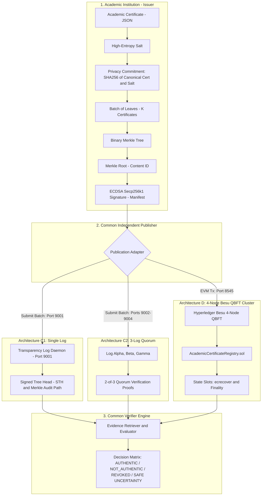

# uniVeri: Academic Certificate Verification & Comparative Publication Architecture

[](https://opensource.org/licenses/MIT)
[](https://www.typescriptlang.org/)
[](https://soliditylang.org/)
[](https://hardhat.org/)
[](https://www.hyperledger.org/projects/besu)
[](https://www.docker.com/)

**uniVeri** is a high-integrity academic certificate verification and publication benchmarking testbed. It provides a standardized cryptographic pipeline and comparative empirical benchmarks across three distinct publication architectures:

1. **C1 (Single Transparency Log):** Append-only transparency log with Signed Tree Heads (STH) and RFC 6962-style cryptographic Merkle audit inclusion proofs (served via standalone HTTP REST daemons).
2. **C2 (3-Log Multi-Quorum):** Distributed log cluster requiring at least a 2-of-3 independent quorum of valid inclusion proofs across isolated services (`Log Alpha`, `Log Beta`, `Log Gamma`).
3. **D (Hyperledger Besu QBFT Blockchain Registry):** Permissionless, on-chain smart contract registry on a 4-node enterprise QBFT private EVM network with on-chain institutional ECDSA signature verification (`ecrecover`), storage-slot mapping, and event-based auditability.

---

## Architecture Overview



---

## Section 4 Benchmark Setup & Testbed Environment

### 1. Hardware & Host Environment
* **CPU Model:** AMD Ryzen 5 5600H with Radeon Graphics (6 Physical Cores, 12 Logical Processors, Base 3.3 GHz, Boost 4.2 GHz).
* **RAM:** 16 GB DDR4 (15.4 GB usable).
* **Disk Type:** 512 GB NVMe PCIe 3.0 x4 M.2 Solid State Drive (`INTEL SSDPEKNU512GZ`).
* **Operating System:** Windows 11 Home Single Language 64-bit (Build 26200 / 24H2) with WSL2 Linux virtualization backend.
* **Docker Engine:** Docker Desktop 4.93.0 / Docker Engine `v29.8.1` (API `v1.56`, containerd `v2.3.5`, runc `v1.5.1`).
* **Host Topology:** All 8 containers run on a single host connected via an isolated Docker bridge network (`testbed-net`, subnet `172.28.0.0/16`).
* **CPU Pinning & Resource Quotas:** No rigid core pinning (`cpuset_cpus`) is enforced to allow the CFS scheduler to utilize all 12 threads. Per-container CFS limits in [`docker-compose.testbed.yml`](docker-compose.testbed.yml):
  * Besu Nodes (`besu-node-1` to `besu-node-4`): `cpus: "2.0"`, `mem_limit: 4g`.
  * Log Daemons (`log-c1-primary`, `log-c2-alpha`, `beta`, `gamma`): Alpine Node.js 22 containers with baseline memory $\sim 50\text{ MB}$ RSS each.

### 2. Software Versions & Consensus Specifications
* **Hyperledger Besu (Architecture D):** `hyperledger/besu:24.7.0` running OpenJDK 64-Bit Server VM (`21.0.3+9-Ubuntu-1ubuntu1`).
* **QBFT Consensus Configuration ([`docker/besu/genesis.json`](docker/besu/genesis.json)):**
  * Chain ID: `1337`
  * Block Period: `1` second (`"blockperiodseconds": 1` for responsive transaction throughput)
  * Epoch Length: `30000` blocks
  * Request Timeout: `4` seconds (`"requesttimeoutseconds": 4`)
  * Gas Limit: `0x1fffffffffffff` ($9 \times 10^{15}$, effectively unconstrained private block capacity)
  * Validators (4 nodes, $3F+1$ where $F=1$):
    * Validator 1: `0x3b79973376f98755a8e234896c11e6c6244315bd` (`172.28.0.11:8545`)
    * Validator 2: `0x627306090abab3a6e1400e9345bc60c78a8bef57` (`172.28.0.12`)
    * Validator 3: `0xd6f74e6ecefcb79cf13a10ec745a735602a87341` (`172.28.0.13`)
    * Validator 4: `0xb5bfc954cb2d17a2d65f72ba7a1986eba79f2365` (`172.28.0.14`)
* **Solidity & EVM Compiler:**
  * Solidity Version: `0.8.24`
  * Optimizer: Enabled, `runs: 200`
  * Intermediate Representation: `viaIR: true`
  * Target EVM: London / Cancun EVM rules
* **Log Daemons & Verifier Runtimes:**
  * Host Runtime: Node.js `v22.12.0` / TypeScript `5.7.2` via `tsx`
  * Web3 & Cryptography: `ethers.js v6.13.4` (secp256k1 ECDSA, `ecrecover`, `verifyMessage`)
  * Canonical JSON: Deterministic strict subset of **RFC 8785** (`src/core/canonical.ts`)
  * REST Daemon Framework: Express `v4.21.2`, CORS `v2.8.5`

### 3. Network Emulation & Timers
* **Network Link Delay ($\Delta$):** Applied via [`scripts/setup-netem.sh`](scripts/setup-netem.sh) on bridge interface `172.28.0.1`:
  * Baseline condition: **$\Delta = 20\text{ ms} \pm 5\text{ ms}$ (25% correlation)**
  * High-latency condition: **$\Delta = 50\text{ ms} \pm 10\text{ ms}$**
* **Timeout Thresholds ($T$):**
  * $T_\text{deadline}$: $1,000\text{ ms}$ (C1/C2) / $6,000\text{ ms}$ (Besu D to accommodate 1s block mining and finality).
  * $T_\text{late}$ (Late Observation Window): $3,000\text{ ms}$ (C1/C2) / $12,000\text{ ms}$ (Besu D).
* **Publisher Release Rates:**
  * **C1 Single Log:** Sequential HTTP burst dispatch ($\sim 40\text{–}100\text{ batches/sec}$).
  * **C2 3-Log Quorum:** Parallel 3-endpoint dispatch requiring 2-of-3 quorum ($\sim 25\text{–}40\text{ batches/sec}$).
  * **D Besu QBFT:** Concurrent mempool batching (`CHUNK_SIZE = 8` pending transactions per 1s block) yielding $\sim 8\text{–}15\text{ batches/sec}$.

---

## Smart Contract & Log Daemons

### Smart Contract: [`AcademicCertificateRegistry.sol`](contracts/AcademicCertificateRegistry.sol)
* **`registerBatch(...)`:** Accepts batch Merkle root, logical batch ID, batch content ID, credential count, and institutional signature. Validates the signature on-chain via `ecrecover` against registered institutions, stores the record in `batchesByContentId`, registers the canonical `logicalBatchToContentId` pointer, and records `registeredBlockNumber` and `registeredAt`.
* **Equivalence & Conflict Detection:** Enforces append-only immutability. If an institution attempts to associate an existing `logicalBatchId` with a different `batchContentId`, the contract emits a `BatchConflictDetected` audit event.
* **`revokeBatch(...)`:** Supports institutional cryptographic revocation events and authorized caller revocation.

### Transparency Log Daemons: [`services/log-daemon/server.ts`](services/log-daemon/server.ts)
* Standalone Express microservices exposing RFC 6962-style endpoints:
  * `POST /v1/manifests`: Receives institutional signed manifests, appends them to the binary Merkle tree, and returns receipt acknowledgments.
  * `GET /v1/proofs/:batchContentId`: Computes and returns Merkle inclusion audit paths bound to the latest Signed Tree Checkpoint.
  * `GET /v1/checkpoint`: Returns operator-signed tree checkpoint (`SignedTreeCheckpoint`).
  * `GET /v1/status/:batchContentId`: Returns all revocation observations with cryptographic inclusion proofs.
  * `POST /v1/admin/fault`: Programmatic fault injection API (`unavailable`, `censorAll`, `readOmitProof`, `staleCheckpointAgeSec`).
  * `POST /v1/admin/reset`: Clears engine state between repetition runs.

---

## Executable Fault Injection Suite (Table 3)

| Fault ID | Script / Endpoint | Failure Semantics |
|---|---|---|
| **C1-F1** | `logManager.logC1.setFailureOptions({ unavailable: true })` | HTTP 503 outage on write and read paths. Publisher retries with exponential backoff. |
| **C1-F2** | `logManager.logC1.setFailureOptions({ acknowledgeButOmit: true })` | Write succeeds (HTTP 200 ACK) but log never incorporates entry into tree; read times out. |
| **C2-F1** | `logManager.logC2A.setFailureOptions({ unavailable: true })` | Log Alpha fails with HTTP 503; Beta and Gamma satisfy 2-of-3 quorum without degradation. |
| **C2-F2** | `logManager.logC2A.setFailureOptions({ readOmitProof: true })` | Alpha ACKs write but drops read proofs; verifier reaches safe quorum from Beta and Gamma. |
| **D-F1 / D-F5** | [`scripts/faults/fault-d-f5-rpc-proxy.ts`](scripts/faults/fault-d-f5-rpc-proxy.ts) | Intercepting proxy on port 8547 that drops connections (`req.socket.destroy()`) or returns HTTP 503 without killing Besu nodes. |
| **D-F2b** | [`scripts/faults/fault-d-f2b-stop-proposer.ts`](scripts/faults/fault-d-f2b-stop-proposer.ts) | Dynamically queries current head block, computes active QBFT round proposer ($\text{Index} = (\text{blockNumber} + 1) \pmod 4$), and pauses that validator container to force a consensus view change. |

---

## Experimental Benchmark Engine & Results

The testbed evaluates **240 total runs** (180 normal runs across workloads W1–W6 $\times$ 3 architectures $\times$ 10 repetitions, plus 60 failure runs):

### Execution Scale
* **20,850 Total Publication Trials** recorded with nanosecond-resolution submission and completion timestamps.
* **180 Verification Queries** measuring cold vs. warm cache retrieval and local verification latencies.
* **1,800 Cgroup Resource Measurements** capturing real container CPU percentages and memory bytes alongside EVM gas counters.
* **8 Phase 3 Correctness Tests** proving formal verification security and safe uncertainty semantics.

### Phase 3 Correctness Test Suite ([`results/correctness_tests.csv`](results/correctness_tests.csv))

All 8 security correctness and safe uncertainty test cases pass (**8/8 `PASS`**):

| Test ID | Description | Architecture | Expected Auth | Observed Auth | Expected Pub | Observed Pub | Expected Status | Observed Status | Verdict |
|---|---|---|---|---|---|---|---|---|---|
| **TC-1** | Unmodified certificate with sufficient publication evidence | C1 | `AUTHENTIC` | `AUTHENTIC` | `PUBLISHED` | `PUBLISHED` | `NO_REVOCATION_OBSERVED` | `NO_REVOCATION_OBSERVED` | **PASS** |
| **TC-2** | Modified certificate claim | C1 | `NOT_AUTHENTIC` | `NOT_AUTHENTIC` | `PUBLISHED` | `PUBLISHED` | `NO_REVOCATION_OBSERVED` | `NO_REVOCATION_OBSERVED` | **PASS** |
| **TC-3** | Invalid Merkle proof path | C1 | `NOT_AUTHENTIC` | `NOT_AUTHENTIC` | `PUBLISHED` | `PUBLISHED` | `NO_REVOCATION_OBSERVED` | `NO_REVOCATION_OBSERVED` | **PASS** |
| **TC-4** | Invalid institution signature | C1 | `NOT_AUTHENTIC` | `NOT_AUTHENTIC` | `INSUFFICIENT_EVIDENCE` | `INSUFFICIENT_EVIDENCE` | `STATUS_UNKNOWN` | `STATUS_UNKNOWN` | **PASS** |
| **TC-5** | Valid certificate but unavailable publication evidence | C1 | `AUTHENTIC` | `AUTHENTIC` | `INSUFFICIENT_EVIDENCE` | `INSUFFICIENT_EVIDENCE` | `STATUS_UNKNOWN` | `STATUS_UNKNOWN` | **PASS** |
| **TC-6** | Genuinely signed stale checkpoint (>300s) | C1 | `AUTHENTIC` | `AUTHENTIC` | `STALE_EVIDENCE` | `STALE_EVIDENCE` | `STATUS_UNKNOWN` | `STATUS_UNKNOWN` | **PASS** |
| **TC-7** | Verified institution-authorized revocation | D | `AUTHENTIC` | `AUTHENTIC` | `PUBLISHED` | `PUBLISHED` | `REVOKED_AS_OF_EVIDENCE` | `REVOKED_AS_OF_EVIDENCE` | **PASS** |
| **TC-8** | Two C2 issuance proofs while Alpha is unavailable | C2 | `AUTHENTIC` | `AUTHENTIC` | `PUBLISHED` | `PUBLISHED` | `STATUS_UNKNOWN` | `STATUS_UNKNOWN` | **PASS** |

### Verified Gas Figures & Resource Measurements
From transaction receipt traces ([`results/publication_traces.json`](results/publication_traces.json)):
* **Calldata Size:** `388` bytes per `registerBatch` transaction
* **Event Log Data:** `224` bytes (`BatchRegistered` event topic and abi-encoded data)
* **Gas Consumption:**
  * Minimum: **294,299 gas**
  * Median: **294,323 gas**
  * Maximum: **294,351 gas**

---

## Getting Started

### Prerequisites
* **Node.js**: `v20.0.0` or higher (`v22` recommended)
* **Docker Desktop**: With Compose support and WSL2 backend (Windows/Linux)

### Installation
```bash
# Clone the repository
git clone https://github.com/jaiswalism/uniVeri.git
cd uniVeri

# Install dependencies
npm install

# Compile Solidity contracts and generate Typechain definitions
npm run compile

# Build TypeScript codebase
npm run build
```

### Running Tests
```bash
# Run all tests (Hardhat contracts + Vitest cryptographic & artifact suites)
npm test

# Run contract tests only
npm run test:contracts
```

---

## Running the Multi-Container Testbed & Benchmarks

1. **Start the Multi-Container Cluster (4 Besu Nodes + 4 Log Daemons):**
   ```bash
   docker compose -f docker-compose.testbed.yml up -d --build
   ```

2. **Verify Cluster Health:**
   ```bash
   # Check Besu QBFT JSON-RPC
   curl -X POST http://127.0.0.1:8545 -H "Content-Type: application/json" -d '{"jsonrpc":"2.0","method":"eth_blockNumber","params":[],"id":1}'
   
   # Check Log Daemons
   curl http://127.0.0.1:9001/health
   curl http://127.0.0.1:9002/health
   ```

3. **Execute the Benchmarking Suite:**
   ```bash
   # Execute the complete 240-run benchmark across all architectures (W1–W6, 10 reps)
   npm run benchmark:testbed

   # Or run the Section 5 Correctness Suite (TC-1 to TC-8) standalone against the live cluster (~25s)
   npm run benchmark:correctness
   ```

4. **Audit Generated Artifacts:**
   ```bash
   npm run validate:artifacts
   ```

5. **Execute Fault Injections:**
   ```bash
   # Stop the active QBFT round leader dynamically (D-F2b)
   npm run fault:proposer

   # Start RPC connection drop proxy on port 8547 (D-F5)
   npm run fault:proxy
   ```

---

## Repository Structure

```
uniVeri/
├── contracts/                              # Smart Contracts
│   └── AcademicCertificateRegistry.sol     # Merkle batch registry with ecrecover & revocation
├── docker/
│   └── besu/                               # Hyperledger Besu genesis.json & validator keys
├── docker-compose.testbed.yml              # 8-container testbed (4 Besu nodes + 4 Log daemons)
├── services/
│   └── log-daemon/                         # Standalone Express REST Transparency Log service
├── scripts/
│   ├── run-all-benchmarks.ts               # Complete dual-mode benchmark suite runner
│   ├── run-correctness-and-queries.ts      # Section 5 correctness evaluator & query generator
│   ├── setup-besu-cluster.ts               # Besu deterministic cluster key generator
│   ├── setup-netem.sh                      # Kernel tc netem network emulation script
│   ├── cgroup-collector.ts                 # Docker container stats / cgroup metrics sampler
│   └── faults/                             # Real-world fault injection scripts
│       ├── fault-d-f2b-stop-proposer.ts    # Halts active QBFT round proposer dynamically
│       ├── fault-d-f5-rpc-proxy.ts         # Injects RPC connection drops on port 8547
│       ├── fault-c1-omission.ts            # C1 omission & stale checkpoint injector
│       └── fault-c2-quorum-failure.ts      # C2 single log failure injector
├── src/
│   ├── benchmark/                          # Workload definitions & artifact validators
│   ├── core/                               # RFC 8785 Canonical JSON, Merkle tree, manifests
│   ├── publisher/                          # Unified publication client with retries
│   ├── services/                           # HTTP REST client and EVM contract adapters
│   └── verifier/                           # Multi-architecture verdict decision logic
├── test/                                   # Hardhat contract tests and Vitest suites
├── results/                                # Raw & Processed Benchmark Artifacts
├── hardhat.config.ts                       # Solidity 0.8.24 viaIR configuration
├── package.json
└── tsconfig.json
```

---

## License

This project is licensed under the [MIT License](LICENSE).
